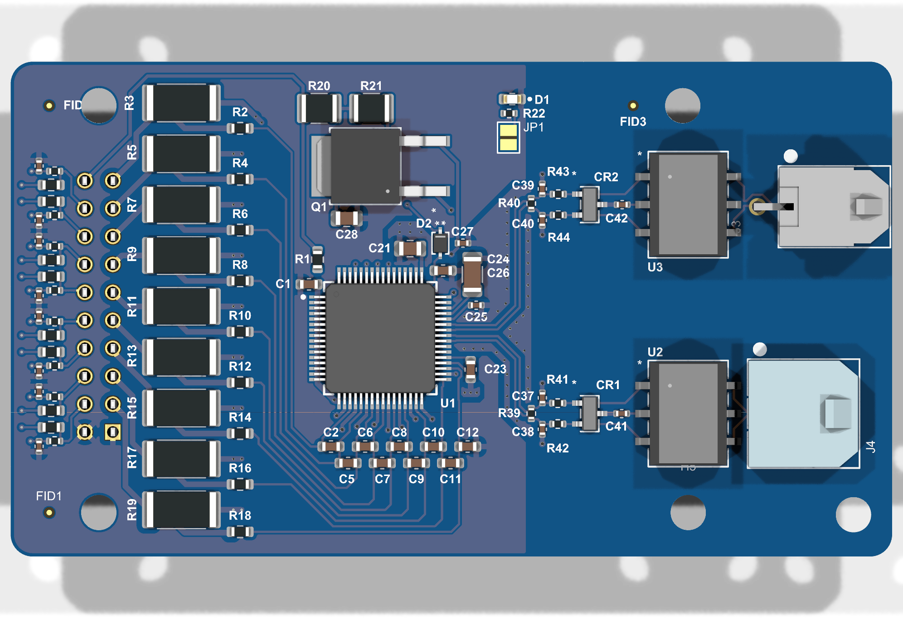
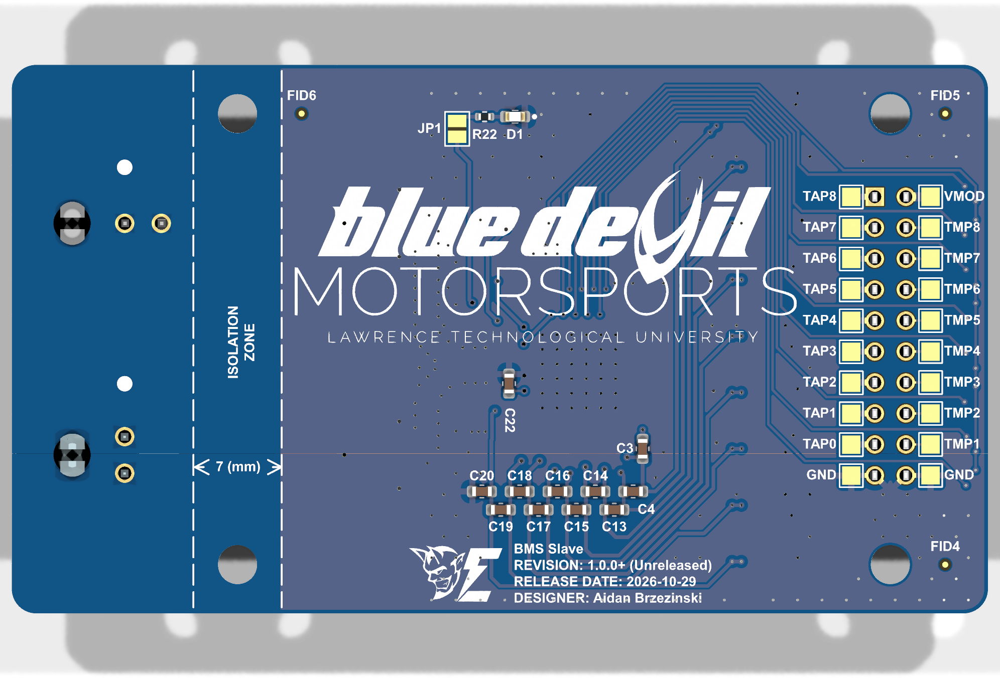

  

<h1 align="center">BMS_SLAVE</h1>

BMS Slave

<em>8S BMS slave board for Blue Devil Motor Sports’ EV27 FSAE Electric accumulator: a TI BQ7961x-Q1 cell monitor with passive balancing, 8 Enepaq temperature channels and a transformer-isolated daisy chain.</em>

  

    

***

  
&nbsp; &nbsp; &nbsp; &nbsp;
  

***

## SPECIFICATIONS

| Parameter | Value |
| --- | --- |
| Dimensions | 80.0 × 45.0 mm |
| Company | Blue Devil Motor Sports |
| Designer | Aidan Brzezinski |
| Revision | 1.0.0+ (Unreleased) |
